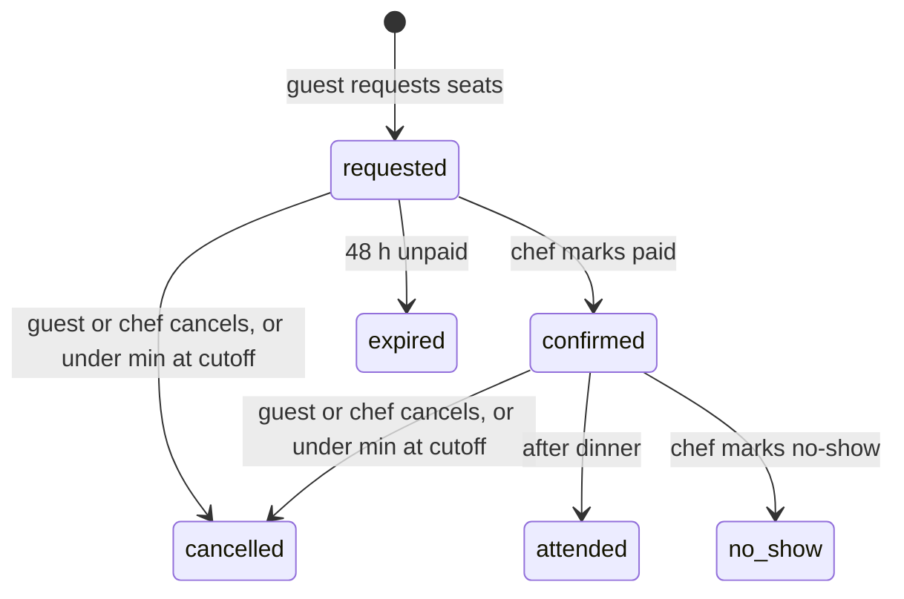

# Dinner Party Marketplace — MVP Strategy Plan

2026-11-12 · u_ewiRxCVn1zaLKhawuQK9KQ

## Summary

The MVP is a curated, NYC-only, ticketed dinner-party marketplace: chefs list dated events with a fixed per-person price and a guest range, and guests book a seat, a group, or the whole table. The core bet is that the supply side (working chefs who want a side stage) and demand side (young professionals looking for a social night out) already exist in NYC, and what's missing is a trustworthy, well-designed place to find each other.

The research points to one recurring cause of death in this category, and it is not demand: Feastly, Josephine and Dinner Lab all had users, and failed on regulation, operating cost, or both. The plan below is shaped around that.

Build instructions for coding agents live in Implementation Guide.

Five decisions that shape everything else:

1. **Legal posture.** Home-hosted paid dinners for the public require a food service permit, per NYC DOHMH's own past statements, and a home kitchen generally can't get one. Decided: BYOB only, max 10 guests per event; the home-hosting health permit remains the main open risk (see NYC regulatory risk).
2. **Curated, not open.** Vet every chef by hand at launch. Supply quality is the product.
3. **Event-first, not chef-hire-first.** Lead with a Luma-style calendar of dated events; full buyouts are a booking type on an event, not a separate private-chef flow.
4. **Payments o****ffline for the MVP****.** Chefs collect directly; the platform records bookings, payment status and attendance so reviews still tie to real guests.
5. **Web-first, responsive.** No native app until booking frequency justifies it.

## Landscape: who has tried this

The category is old and crowded with failures; the survivors either went global-travel (Eatwith), chef-to-your-home (Take a Chef, Airbnb Services), or restaurant-hosted (Timeleft). Nobody obviously owns "local ticketed supper clubs for NYC 20s–30s."

| Company | Model | Take rate | Status | Lesson for us |
|---|---|---|---|---|
| [Eatwith](https://intercom.help/eatwith/en/articles/432396-does-eatwith-charge-a-commission-on-the-price-i-pay-for-my-experience) | Hosts list dinners, classes, tours; guests buy seats. Travel-led, but 70–80% of its NYC guests were locals ([Gear Patrol](https://www.gearpatrol.com/?p=210135)) | 30% added on top of host price (guest-paid) | Alive; absorbed London's Grub Club in 2018 | Locals are the real NYC customer; a guest-side fee is tolerated |
| [Feastly](https://www.sharetribe.com/create/how-to-build-website-like-feastly/) | Home chefs list dinners in DC, NYC, SF | ~20% ([KQED/NPR](https://www.kqed.org/bayareabites/54578/matching-diners-to-chefs-startups-hatch-underground-supper-clubs)) | Shut down 2018 | Regulation, insurance, and trust in private homes |
| [Josephine](https://www.thefoodcorridor.com/blog/mehkos-2026-2) | Home cooks sell meals for pickup | — | Shut down 2018 after cease-and-desist letters to cooks | Cooks bore the legal risk; regulators acted on individual cooks |
| [Dinner Lab](https://techcrunch.com/2016/04/14/dinner-lab-suspends-operations-after-failing-to-find-a-sustainable-business-model/) | Membership (~$150/yr) + ~$65 pop-ups in unusual venues, 30 cities | Owned the events | Shut down 2016 after ~$9M raised | Running events yourself (staff, venues, sourcing) is a cost trap; a Harvard analysis argued one-city focus (NYC) would have helped |
| [Timeleft](https://www.stripes.com/living/2024-08-26/web-lifestyle-loneliness-app-meals-meetup-conversation-networking-community-14981930.html) | Subscription; matches 6 strangers for Wednesday dinners at partner restaurants; NYC is its busiest US market | Subscription (~$25/mo cited) | Alive, ~300 cities | Strong proof of "dinner with strangers" demand in our exact demographic |
| [Take a Chef](https://www.takeachef.com/en-us/faqs) | Hire a chef to cook at your home | Commission per booking | Alive, global | Proves the full-buyout / private-hire side |
| [Airbnb Services](https://cresta.com/news/airbnb-revamps-app-with-ai-services) | Book private chefs and other pros, launched May 2025 | 15% on services, 20% on experiences | Alive, 260 cities | A large incumbent sits next to the buyout use case; we shouldn't compete on private-hire alone |
| [Supper at Home](https://thespoon.tech/?p=58022) | Dine-in meals at home cooks' homes, small groups, fixed menu | — | Early; Hawaii, where law now permits it | Closest model to ours, and it exists where the law changed |

The NYC supper-club scene itself is active outside platforms: the NY Post profiled several ticketed home dinners (e.g. a Bushwick club, a $150 Shabbat supper club) that sell via Instagram and link-in-bio ticketing ([NY Post via AOL](https://www.aol.com/articles/rise-dinner-partygoers-forget-nightclubs-190121825.html)). That's both our supply pool and our competition: their current tooling is Eventbrite/Partiful plus DMs.

## Lessons from analog marketplaces

The closest structural analog is Airbnb Experiences plus Luma, not Uber: supply is scheduled and scarce (a dinner happens once, for 8–14 people), not on-demand and fungible.

| Model | What transfers | What doesn't |
|---|---|---|
| Airbnb (homes + Experiences) | Host profiles, verified reviews tied to a completed stay, approximate location until booking, host vetting, guest-side service fee | Instant book at scale; our inventory is tiny and dated |
| Luma / Eventbrite | Calendar-first discovery, clean event pages, capacity + waitlist, shareable links, attendee lists | They're neutral ticketing tools with no curation or trust layer — that's our wedge |
| Timeleft | Solo-friendly "join strangers" seat as a first-class option; low-friction first booking | Algorithmic matching; restaurant venues |
| Resy / OpenTable | Deposits and cancellation policies that reduce no-shows | Table-turn inventory model |
| Uber | Two-sided ratings; platform holds payment until service is done | On-demand dispatch and dynamic pricing don't apply |

Patterns worth copying directly:

- **Fuzzy location until booked.** Airbnb shows an approximate area and reveals the address after booking. This matches your neighborhood-level plan; reveal the exact address 24–48 hours before the event.
- **Reviews only from verified attendees.** Tie every review to a booking the chef marked as attended.
- **Payout after the event.** Later, once payments move on-platform: hold funds and pay chefs after the dinner (Stripe Connect supports this), which gives a lever for refunds and no-shows.
- **Minimums.** Events need a "go/no-go" threshold: if minimum guests aren't reached by a cutoff, the event is cancelled and everyone is refunded automatically.

## NYC regulatory risk

Decided for launch: keep it small and BYOB — at most 10 guests per event, no alcohol sold or included in the price, and payments handled offline. That settles alcohol; the health-permit question is still open, and small size reduces exposure rather than making home-hosted public dinners compliant. This is research, not legal advice.

| Area | Decision | Basis |
|---|---|---|
| Alcohol | BYOB only. Chefs never sell drinks or fold them into the ticket price. | Charging more for a meal with wine can count as a prohibited indirect sale ([Airbnb NYC alcohol guidance](https://www.airbnb.lv/help/article/1780)). Unlicensed BYOB is reported allowed where occupancy is 19 or fewer, per SLA Advisory 2022-31 ([Rental Awareness](https://rentalawareness.com/byob-laws-in-new-york/); confirm against the advisory itself) |
| Size | Hard cap of 10 guests per event, enforced in the product | Stays well under the 20-person BYOB line; keeps events dinner-party sized |
| Payments | Offline; chefs collect directly, the platform only records bookings | Keeps the platform out of the money flow for now |
| Sales tax | Chefs are the sellers and collect tax on tickets | NY taxes dining-event tickets ([TSB-A-14(4)S](https://tax.ny.gov/pdf/advisory_opinions/sales/a14_4s.pdf)); each chef needs a free Certificate of Authority |
| Health permit | Open | Home-hosted paid dinners for the public need a DOHMH permit per the statements below; options listed further down |

What the sources say:

- NYC DOHMH has stated publicly that people who offer meals to the public for money are food service establishments and need permits, and that the city does not allow meals to be served to the public in someone's home ([Reason, quoting DOHMH to Bloomberg Businessweek](https://reason.com/?p=236483); [Washington Times/CBS](https://m.washingtontimes.com/news/2013/sep/13/underground-illegal-dinner-clubs-make-waves-among-/)). These statements are from 2013–2014; current enforcement posture is unverified.
- Airbnb's NYC guidance frames the open question as whether occasional home-cooked meals for guests count as a regulated activity, and says unless an exemption applies, food service establishments must be permitted ([Airbnb help](https://www.airbnb.dk/help/article/1763)).
- In practice, NYC home supper clubs operate openly; a 2025 NY Post piece reported no specific rules on hosting dinner parties at home ([NY Post via AOL](https://www.aol.com/articles/rise-dinner-partygoers-forget-nightclubs-190121825.html)). That reads as low enforcement, not legality.
- Elsewhere the law has moved: California's MEHKO law (AB 626) and Hawaii now allow home-kitchen meals under caps, and platforms followed ([The Food Corridor](https://www.thefoodcorridor.com/blog/mehkos-2026-2); [The Spoon](https://thespoon.tech/?p=58022)). New York has no equivalent that I found.

Risk-reducing options for the MVP, roughly in order of safety:

1. **Venue-hosted events** — chefs cook in permitted spaces (commissary kitchens, restaurants on dark nights, event spaces with a kitchen). Lowest risk; adds cost.
2. **Chef holds credentials** — require a NYC Food Protection Certificate and liability insurance at intake, and show badges on profiles.
3. **Private-event framing** — full buyouts by one host who invites their own guests look more like private catering than public food service. Worth asking a lawyer whether this changes the analysis.
4. **Home-hosted, public seats** — the highest-risk configuration, and the one the original concept centres on.

The venue-partnership feature you planned for later may need to be earlier: it's the legal path, not just a growth feature.

Also unresolved: platform liability for foodborne illness or injury at a home event, sales tax collection on tickets, and co-op/lease restrictions for hosts.

## Positioning and brand

Position it as "a better night out than a restaurant, easier than hosting": warm, social, chef-driven, not fine dining.

**Guests (demand).** NYC young professionals, roughly 25–38, who already spend on going out. Three jobs:

- _Solo / meet people_ — the Timeleft job: a social night with strangers, low commitment.
- _Small group night out_ — 2–5 friends who want something more memorable than a restaurant.
- _Hosting an occasion_ — birthdays, team dinners, dates: buy out the table.

**Chefs (supply).** Line cooks and sous chefs wanting their own stage, culinary-school grads, existing supper-club operators, private chefs filling off-nights. They want: bookings without DM chaos, payment collected up front, a portfolio of past dinners and reviews.

**Brand direction.**

- Tone: warm, a little playful, confident; no "curated culinary journey" language.
- Visual: editorial food photography of real tables (candles, mismatched plates, people mid-laugh) over plated close-ups; one warm accent colour; a serif display face paired with a clean sans.
- References to study: Luma (event pages), Resy (polish without stiffness), Airbnb Experiences (host storytelling), Timeleft (approachable solo onboarding).
- Name: still open; worth testing 3–5 candidates with target users.

## MVP scope

The MVP proves one loop: a chef lists a dinner, guests discover and pay for seats, the dinner happens, guests review it. Everything else is deferred.

**Chef side — in MVP**

- [ ] Google sign-in, then an intake application (bio, credentials, website/Instagram, cuisine categories, sample menu upload, photos, hosting setup: home or venue, needs FOH/servers/venue — stored now, used later)
- [ ] Manual approval by admin before a chef can publish
- [ ] Create event: date, start time, duration, neighborhood + private address, cuisine tags, menu (text + optional PDF), fixed price per person, min and max guests (max capped at 10), which booking types are allowed (seat / group / full buyout), dietary notes, BYOB guidance (BYOB only; no alcohol sold)
- [ ] Event dashboard: guest list, headcount vs. minimum, guest dietary notes, message all guests
- [ ] Public profile: bio, credentials, past events count, average rating, reviews
- [ ] Mark each booking as paid (offline) and, after the dinner, as attended or no-show

**Guest side — in MVP**

- [ ] Browse upcoming events: list + calendar view, filters for date, borough/neighborhood, cuisine, price, party size, "solo-friendly"
- [ ] Event page: menu, chef, neighborhood + nearest intersection on a map, seats left, price
- [ ] Book: choose solo seat, group of 2–5, or full buyout; request the spot and see the chef's payment instructions; seat confirms once the chef marks it paid; dietary notes
- [ ] Google sign-in; profile with dinners attended
- [ ] Exact address emailed 24–48 h before
- [ ] Post-event: star rating + written review, shown anonymously

**Admin — in MVP**

- [ ] Approve/reject chefs, unpublish events, cancel bookings, remove reviews

**Deferred**

- Native mobile apps
- Venue marketplace and FOH/server staffing matching
- Guest-to-guest messaging, matching algorithms
- Chef-proposed private hires on arbitrary dates (request-a-date flow)
- Waitlists, gift cards, memberships
- On-platform payments, refunds and the automated 10% take

## Booking model

Every event is either _open_ (seats sold to the public) or _bought out_ (one party owns it); the first booking decides which.

| Booking type | Party size | Price | Effect on the event |
|---|---|---|---|
| Solo seat | 1 | price × 1 | Event becomes open; buyout no longer offered |
| Group | 2–5 (cap configurable) | price × party size | Same as above; group is seated together |
| Full buyout | chef's min to max (10 at most) | price × party size, never below price × min | Event closes to the public immediately |

Rules:

1. **Capacity.** Seats requested or confirmed can never exceed the chef's max, which is capped at 10. A group that doesn't fit isn't offered.
2. **Go/no-go.** Each open event has a cutoff (default 72 h before). If seats sold are below the chef's minimum, the event auto-cancels and everyone is notified; the chef refunds anyone who already paid.
3. **Payment is offline****.** A booking starts as requested and shows the chef's payment handle; the chef marks it paid once money arrives, which confirms the seat. Unpaid requests expire after 48 h.
4. **Cancellation (draft).** Guest cancels more than 7 days out: full refund. 2–7 days: 50%. Under 48 h: none, unless the seat is resold. Chef cancels: full refund, and it's recorded on their profile. Refunds are paid back by the chef offline; the platform records the cancellation.
5. **Fee.** The 10% is settled offline for now; keep a platform_fee_cents field on bookings so it can be recorded and reported. Worth deciding whether the fee sits on the guest's side (Eatwith adds its fee on top of host price) or comes out of the chef's price.

## Data model

One `users` table with roles keeps auth simple: a person can be both a guest and a chef. Eight tables cover the MVP, plus booking_log (see Engineering design); payouts are deferred. Postgres.

| Table | Key fields | Relationships |
|---|---|---|
| users | id, google_sub, email, name, avatar_url, phone, roles (guest/chef/admin), created_at | 1–1 chef_profiles; 1–many bookings, reviews |
| chef_profiles | user_id, display_name, slug, bio, credentials, website, instagram, home_borough, status (applied/approved/rejected/suspended), food_cert_number, insurance_on_file, needs_foh, needs_servers, needs_venue, payment_handle (Venmo/Zelle, shown after a seat request) | 1–many events, menus |
| cuisines | id, name (fusion, bistro, Cantonese, ...) | many–many chef_profiles and events |
| menus | id, chef_id, title, courses (JSON), pdf_url, is_sample | 1–many events |
| venues | id, type (chef_home / partner_venue), address (private), neighborhood, borough, cross_streets, lat/lng (public, rounded), capacity, owner_user_id | 1–many events |
| events | id, chef_id, venue_id, menu_id, title, starts_at, duration_min, price_cents, min_guests, max_guests (≤ 10), allowed_booking_types, go_no_go_at, mode (unsold/open/bought_out), status (draft/published/cancelled/completed), byob, dietary_notes | 1–many bookings, reviews |
| bookings | id, event_id, guest_user_id, type (seat/group/buyout), party_size, amount_cents, platform_fee_cents, status (requested/confirmed/expired/cancelled/attended/no_show), paid_marked_at, address_sent_at, review_requested_at, dietary_notes | 1–1 review |
| reviews | id, booking_id (unique), event_id, chef_id, rating 1–5, body, is_anonymous (default true), created_at | belongs to booking |
| payouts | Deferred until payments move on-platform | belongs to event |

Derived fields to compute rather than store at first: chef's dinners hosted (completed events), average rating, guest's dinners attended (bookings with status attended).

Two constraints to enforce in the database, not just the app: max_guests ≤ 10, and requested + confirmed party_size per event ≤ max_guests (use a row lock on the event during booking), and one review per booking.

## Tech stack and architecture

A single TypeScript web app on managed services is enough for the MVP; one engineer can build it, and nothing here needs custom infrastructure.

> **Diagram (in the Claude doc):** MVP architecture · one app, one database, four services

| Layer | Choice | Why |
|---|---|---|
| Web app | Next.js + TypeScript + Tailwind, on Vercel | One codebase for pages and API; responsive by default |
| Auth | Google OAuth via Auth.js (or Supabase Auth) | Matches your Google-only sign-in plan |
| Database | Postgres (Neon or Supabase) + Prisma or Drizzle | Relational fits events/bookings; transactions prevent overbooking |
| Payments | None in the MVP (offline); Stripe Connect Express later | When payments move on-platform: collects, holds, pays chefs, handles KYC and 1099s |
| Email | Resend + React Email | Booking confirmations, address reveal, review requests |
| Maps | Mapbox or Google Maps, showing a rounded point or neighborhood shape only | Never send the exact coordinates to the browser |
| Files | Supabase Storage or S3 | Menu PDFs, chef and event photos |
| Jobs | Vercel Cron or Inngest | Go/no-go checks, 48 h address reveal, post-event review email, expiring unpaid requests |
| Admin | Simple protected pages in the same app | Chef approvals, cancellations, moderation |

Alternatives if you'd rather not hand-build: Sharetribe (a hosted marketplace builder) could stand up listings, bookings and payments faster, at the cost of less control over the seat/group/buyout logic.

## Engineering design

One Postgres database is the single source of truth, and the web app is its only writer. Private fields (exact address, contact details, payment handles) live in the same database but leave the server only after a role and booking check. At 10 guests per event and a few dinners a week, nothing here needs caching, queues or a search engine.

### Data stores

| Store | Holds | Notes |
|---|---|---|
| Postgres | Users, chef profiles, cuisines, menus, venues, events, bookings, booking log, reviews | All writes in transactions; indexes on events (starts_at, status, borough) cover discovery queries |
| File storage | Menu PDFs, chef and event photos | Public-read; uploads go through signed URLs issued by the app |
| Email provider | Nothing stored by us | Outbound only: confirmations, address reveal, reminders, review requests |
| Auth sessions | Session rows in Postgres (Auth.js adapter) | Google is the only identity provider |

One table is added beyond the Data model section: `booking_log` (booking_id, from_status, to_status, actor_user_id, note, at), append-only. With payments offline, this log is the record of who confirmed what and when.

### Who can see what

| Data | Public | Signed-in guest | Guest with confirmed booking | Chef (own events) | Admin |
|---|---|---|---|---|---|
| Event, menu, price, seats left | Yes | Yes | Yes | Yes | Yes |
| Neighborhood + nearest intersection | Yes | Yes | Yes | Yes | Yes |
| Exact address | No | No | From 48 h before | Yes | Yes |
| Chef payment handle | No | After requesting a seat | Yes | Yes | Yes |
| Guest names and party sizes | No | No | No | Yes | Yes |
| Guest email and dietary notes | No | No | Own only | Yes | Yes |
| Review text and rating | Yes | Yes | Yes | Yes | Yes |
| Reviewer identity | No | No | No | No | Yes |

Enforcement rule: event pages are rendered from a public query that never selects private columns; private fields come only from separate server functions that check role and booking status. Map coordinates are rounded (about 3 decimal places) before they're stored in the public column.

### Write paths

| Action | Who | Writes | Checks |
|---|---|---|---|
| Apply as chef | Signed-in user | chef_profiles (status applied) | One profile per user |
| Approve / reject chef | Admin | chef_profiles.status | — |
| Create / publish event | Approved chef | events | max_guests ≤ 10, min ≤ max, starts in the future, venue belongs to chef |
| Request seats | Guest | bookings (requested), booking_log, events.mode | Row lock on the event; requested + confirmed party sizes ≤ max; buyout only if no other bookings |
| Mark paid | Chef | bookings (confirmed), booking_log | Booking is on chef's event, still requested |
| Cancel | Guest or chef | bookings (cancelled), booking_log | Before event start |
| Mark attended / no-show | Chef | bookings, booking_log | After event start |
| Leave review | Guest | reviews | Booking attended, one per booking, within 30 days |

A requested booking holds its seats until it's confirmed or expires, so two guests can't both claim the last seat while each is paying the chef.

### Scheduled jobs

One hourly cron sweeps for rows that are due; each job writes a timestamp so re-runs do nothing twice.

| Job | Due when | Does | Idempotency marker |
|---|---|---|---|
| Expire requests | Requested > 48 h | Marks expired, frees seats, emails guest | booking status |
| Go / no-go | events.go_no_go_at passed | Confirmed guests < min → cancel event and bookings, email everyone | event status |
| Address reveal | 48 h before start | Emails exact address to confirmed guests | bookings.address_sent_at |
| Close event | Start + duration passed | Marks event completed, asks chef to mark attendance | event status |
| Review request | Booking marked attended | Emails a review link | bookings.review_requested_at |

Chef stats (dinners hosted, average rating) and guest stats (dinners attended) are SQL views over events, bookings and reviews; materialize them only if pages get slow.

### Data flow

> **Diagram (in the Claude doc):** Data flow · 7 steps from chef approval to review

The chef marking a booking paid is the one step that depends on something outside the system, so it's the one step the booking log matters most for.

### Booking states

A seat is held while `requested`; the chef confirms it once paid.

Only requested and confirmed bookings count against the 10-seat cap. Every transition writes a booking_log row, and only the listed actor can make it.

## Go-to-market and cold start

Start supply-first and tiny: 10–15 hand-picked chefs and 2–4 dinners a week in a few neighborhoods beats 100 chefs with empty calendars.

1. **Seed supply by hand.** Casa Wong can be launch host and design partner. Recruit from ICE alumni, line cooks you know, and existing NYC supper clubs on Instagram. Pitch: free tools, payment collected up front, a public track record.
2. **Run the first dinners as concierge.** Before the product is built, sell seats for a handful of dinners through a simple form, with chefs collecting payment directly. This tests price, fill rate and the solo-seat appeal for near-zero engineering.
3. **Concentrate geography.** Start in 2–3 neighborhood clusters (e.g. Williamsburg/Greenpoint, LES/East Village) so supply and demand overlap.
4. **Demand channels.** Chef-driven Instagram/TikTok (each chef brings their own audience; the platform is their booking link), run-club and climbing-gym partnerships, workplace ERGs for team buyouts.
5. **Measure.** Fill rate per event, % events hitting minimum, repeat guests within 60 days, chef retention month over month, review average.

A sensible signal to start building beyond MVP: about 70%+ average fill and some guests booking a second dinner within two months. These thresholds are judgment calls, not industry benchmarks.

## Roadmap

Roughly six months to a launched marketplace in a few neighborhoods, with the riskiest question (legal path and real demand) answered in the first month, before any booking code.

Validate with hand-run dinners before building the booking system. Durations are estimates.

| Phase | When | Work | Gate to the next phase |
|---|---|---|---|
| Validate | Weeks 1–4 | Lawyer consult; sell 5–8 dinners paid offline; recruit 5 chefs | 70%+ fill, legal path chosen |
| Build MVP | Weeks 5–12 | Auth, chef intake; events and booking; paid/attended tracking; reviews, admin | First paid on-platform dinner |
| Launch | Months 4–6 | 2–3 neighborhoods; 2–4 dinners a week; 10–15 chefs; fee settled offline | Repeat guests within 60 days |
| Expand | Month 7 on | Venue partners; FOH staffing; private-hire requests; native app, if needed | — |

Durations assume one engineer part-time plus your evenings; the gates matter more than the dates. If gate 1 fails on legality, the plan shifts to venue-hosted events, not to a different product.

## Open questions

- [ ] Legal: BYOB and a 10-guest cap are decided. Still open: home-hosted public seats vs. venue or buyout only, which turns on the health permit. Get a NYC food/hospitality lawyer's opinion.
- [ ] Alcohol: decided, BYOB only. Confirm the 19-person BYOB rule against SLA Advisory 2022-31 itself.
- [ ] Fee: does the eventual 10% come from the chef's price or sit on top for the guest?
- [ ] Anonymous reviews: fully anonymous to everyone, or visible to the chef only? Anonymity reduces accountability for unfair reviews.
- [ ] Should guests be reviewable by chefs (no-shows, behaviour), as Airbnb does both ways?
- [ ] Max group size for non-buyout bookings: 5, or chef-set?
- [ ] Vetting bar: what credentials or trial dinner does a chef need to pass?
- [ ] Name and domain.

## Sources

- [Eatwith commission (help center)](https://intercom.help/eatwith/en/articles/432396-does-eatwith-charge-a-commission-on-the-price-i-pay-for-my-experience)
- [Gear Patrol: Inside the New American Supper Club](https://www.gearpatrol.com/?p=210135)
- [Sharetribe: How to build a website like Feastly](https://www.sharetribe.com/create/how-to-build-website-like-feastly/)
- [KQED/NPR: Matching diners to chefs](https://www.kqed.org/bayareabites/54578/matching-diners-to-chefs-startups-hatch-underground-supper-clubs)
- [The Food Corridor: MEHKOs in 2026](https://www.thefoodcorridor.com/blog/mehkos-2026-2)
- [The Spoon: home-kitchen marketplaces and Supper at Home](https://thespoon.tech/?p=58022)
- [TechCrunch: Dinner Lab shuts down](https://techcrunch.com/2016/04/14/dinner-lab-suspends-operations-after-failing-to-find-a-sustainable-business-model/)
- [Harvard Digital Initiative: Dinner Lab analysis](https://d3.harvard.edu/platform-digit/?p=4797)
- [Stars and Stripes/WaPo: Timeleft](https://www.stripes.com/living/2024-08-26/web-lifestyle-loneliness-app-meals-meetup-conversation-networking-community-14981930.html)
- [Take a Chef FAQ](https://www.takeachef.com/en-us/faqs)
- [Cresta: Airbnb Services commissions](https://cresta.com/news/airbnb-revamps-app-with-ai-services)
- [Reason: DOHMH on home dinner permits](https://reason.com/?p=236483)
- [Washington Times: NYC underground dinner clubs](https://m.washingtontimes.com/news/2013/sep/13/underground-illegal-dinner-clubs-make-waves-among-/)
- [Airbnb: NYC food experiences guidance](https://www.airbnb.dk/help/article/1763)
- [NY Post via AOL: NYC dinner party scene](https://www.aol.com/articles/rise-dinner-partygoers-forget-nightclubs-190121825.html)

Sources are from web searches; I didn't open every page in full, so treat specific figures (take rates especially) as worth re-checking.
